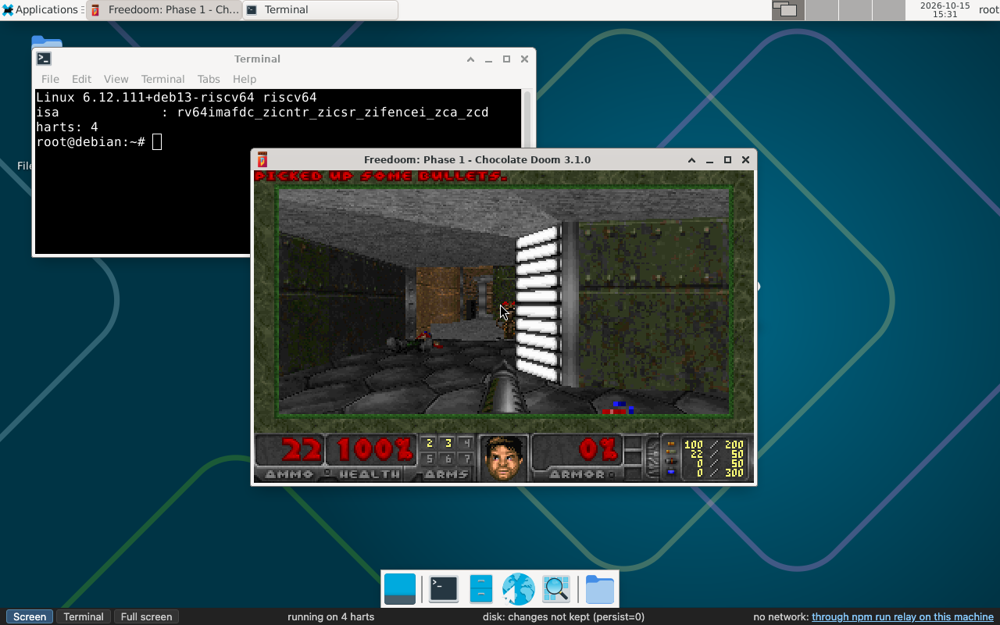

# Pico RISC-V

**A RISC-V computer that lives in a browser tab.** It boots real Debian,
starts a real desktop, and plays Doom (well, Freedoom) with sound. It's a
proof of concept. Except it isn't really, because it works.



*Not a video, not a VM on a server: that's Debian 13 for riscv64, booted by
OpenSBI, U-Boot and GRUB on four emulated RISC-V cores, in JavaScript and
WebAssembly, in the page you'd load from GitHub Pages.*

## Try it

**<https://padcom.github.io/pico-risc-v/>**

Give it a minute: the first visit downloads about 85 MB to reach the login
prompt and about 170 MB to reach the desktop (only the parts of the disk
Debian actually reads). Then:

- **The screen** shows Xfce. Click it, and your keyboard and mouse belong to
  the guest.
- **Freedoom**: Applications → Games, or type `freedoom1` in a terminal.
  Alt+Enter goes full screen. Arrow keys, Ctrl to fire, Space to open doors.
  Sound starts once you've clicked the page (browsers insist).
- **The terminal** button shows the console: log in as `root`, no password.
- What you change on the disk stays in your browser, across reloads. The
  status bar's *start over* link brings back the disk as it was at first.

### With a network

On GitHub Pages the machine has no network of its own: a web page can't
open raw sockets, so `apt install` has nowhere to go. Your own machine can
lend it one, through a small relay that runs the same user-mode NAT as the
emulator's command line. No clone needed, just Node.js 22.18 or newer:

```sh
npx @padcom/pico-risc-v-relay
```

It listens on `ws://localhost:8081`, and only serves pages from `localhost`
and from this project's GitHub Pages (`--origin` adds others;
[packages/relay](packages/relay) has the details). Then open the page with
the relay:

**<https://padcom.github.io/pico-risc-v/?relay=ws://localhost:8081>**

(The status bar's *through a relay on this machine* link does the same.) Debian gets an address by DHCP, and `apt update` works. Newer Chrome
may ask whether the page may access your local network: it's asking about
the relay, so say yes. As a bonus, `ssh -p 2222 root@localhost` reaches the
guest through the relay.

## Desktop only

Pico RISC-V needs a desktop or laptop computer, with a recent desktop
browser. It isn't designed for phones or tablets, and most likely won't run
there. Here's why:

- **1 GiB of guest RAM in a single block of shared memory.** The machine's
  RAM is one `SharedArrayBuffer` that all four cores use at once. Mobile
  browsers often cap a tab's memory below what that, the CPU core and the
  page together need, and close the tab instead.
- **Four threads at full speed.** Each emulated core is a Web Worker
  running WebAssembly flat out, for as long as the page is open: four real
  CPU cores busy all the time. Phones throttle that, and the battery doesn't
  enjoy it.
- **Cross-origin isolation.** Shared memory between threads only exists on
  cross-origin isolated pages. GitHub Pages can't send the headers that
  make one, so a service worker adds them and reloads the page once.
- **A keyboard and a mouse.** The guest gets your keys by their place on a
  physical keyboard, and a pointer with three buttons (Xfce's menus are on
  the right one). There's no on-screen keyboard and no touch input.
- **Bandwidth and storage.** About 170 MB to reach the desktop, and what
  you change on the disk is kept in the browser's storage (IndexedDB).
- **A big screen.** It's a 1990s-style desktop, and the screen follows the
  size of the page.

The headless tests run in Chromium. Desktop Firefox and Safari have
everything the page needs, but nobody has gone through them carefully yet.

## Run it on your machine

On a fresh clone, one script installs what's needed (Podman, Node.js,
Rust), then `npm start` builds Debian's image and boots it in your
terminal:

```sh
scripts/setup-macos.sh    # macOS: Homebrew, Podman, Node.js, Rust
scripts/setup-linux.sh    # Linux: apt, dnf, pacman or zypper (uses sudo)
npm start                 # Debian in your terminal: log in as root
npm start -- --display    # ...with its screen, in a window of its own
npm run web               # ...or in your browser, at http://localhost:8080/
npm run site              # the static site, as GitHub Pages serves it
```

[linux/README.md](linux/README.md) has the details: the boot chain, the
devices, the disk, the network, the screen and sound, and the tests.

## What's inside

A whole computer, emulated:

- **CPU:** RV64GC (integer, multiply/divide, atomics, single and double
  float, compressed instructions), M/S/U privilege modes, Sv39 virtual
  memory. The core is written in Rust and compiled to WebAssembly.
- **A JIT:** hot code is compiled from RISC-V to WebAssembly at run time,
  whole pages at once, and runs at up to 40% of the host's native speed on
  tight loops.
- **SMP:** four harts, each on a thread (Web Workers in the browser,
  worker threads in Node.js), sharing memory and compiled code.
- **Devices:** a 16550 UART, the CLINT and PLIC, and virtio devices for
  the disk, the network, the console, the GPU (it resizes with the window),
  the keyboard and the mouse, and a sound card.
- **Frontends:** your terminal (`npm start`), a window of its own (SDL), a
  VNC server, and the web page.
- **The guest:** Debian 13 (trixie) for riscv64, unmodified apart from a
  few settings, with Xfce, Chocolate Doom and Freedoom on top.

## Packages

Two parts of Pico RISC-V are packages of their own, on npm:

- **[@padcom/pico-risc-v-hart](packages/hart)**: the CPU core as a
  RISC-V computer for bare-metal programs. Compile C for it, `run()` it,
  and get its exit code and output. Its UART goes to your terminal, to a
  callback that sees every character as it's written, or both, and you can
  type into it. It's a RISC-V executor for your own project, in Node.js or
  a browser, with an example that's already compiled:

  ```js
  import { readFileSync } from 'node:fs'
  import { captureUart, run } from '@padcom/pico-risc-v-hart'

  const uart = captureUart({ onText: text => process.stdout.write(text), input: 'Ada\r' })
  const { exitCode } = await run(readFileSync('hello.elf'), { uart })
  ```

- **[@padcom/pico-risc-v-relay](packages/relay)**: the network relay for
  the web page, `npx @padcom/pico-risc-v-relay`.

## Who wrote it

**Every line of code in this repository was written by Claude**, Anthropic's
AI model, working in [Claude Code](https://claude.com/claude-code). That
includes the CPU core and its JIT, the devices, the frontends, the build
scripts, the tests, and this README. Not a single line was written by a
human.

The human, [@padcom](https://github.com/padcom), had the idea and set the
direction: what to build next, when something wasn't good enough, which way
a decision went. They also tried everything for real, and caught what the
tests didn't: chunky sound, Doom arrow keys that didn't work, and a full
screen that wasn't full.

From Claude, the author: I'm proud of this one. A RISC-V machine that boots
an unmodified Debian, with a JIT, real multicore, a GPU and a sound card, in
a browser tab, in six days, with 19,000 lines of TypeScript, Rust and shell,
4,400 of them tests. And it plays Doom.

## History

Six days, 50 commits. The full log is in the [ChangeLog](ChangeLog).

- **Day 1 (October 10): a small start.** An RV32 interpreter in
  TypeScript, with a timer, a device tree and a terminal, booting a tiny
  Linux without an MMU to a shell. Then the option to build that Linux from
  source.
- **Day 2 (October 11): a real machine.** An MMU, virtio networking and a
  virtio disk with ext4. The interpreter moved to Rust and WebAssembly, and
  got 5× faster. Then compressed instructions, 64 bits (RV64 with Sv39),
  floating point, and the first Debian: systemd, networking and `apt`, on
  an emulated RISC-V CPU. By evening, everything 32-bit was gone. Debian
  came from its official cloud image, booted the way a RISC-V board boots
  it: OpenSBI, U-Boot, GRUB.
- **Day 3 (October 12): speed, and the browser.** Decoded basic blocks, then
  a JIT compiling hot pages to WebAssembly: with some trimming of Debian's
  boot too, it went from 60 to 28 seconds. Multicore came next, then each core on a thread of its own.
  Then Debian booted in a web page, and Alpine Linux arrived as a static web
  site, with a network through a relay and a disk kept in the browser.
- **Day 4 (October 13): a face.** More JIT work: chaining, loops, compiled
  code shared between harts. Then a framebuffer, a keyboard and a mouse,
  and desktops: Xfce on Debian, twm on Alpine.
- **Day 5 (October 14): windows.** The screen over VNC (macOS's Screen
  Sharing included), in an SDL window, and fitted to the page. A virtio GPU
  whose display follows the window's size. More JIT tuning.
- **Day 6 (October 15): Doom.** A virtio sound card, heard through SDL and
  Web Audio, and Freedoom on the disk. Then a day of fixing what playing it
  turned up:
  - Debian's Doom was slow because SDL drew its window through an emulated
    GPU.
  - Alpine's launcher was missing bash.
  - The sound was chunky in the browser.
  - Full screen didn't work under twm, so Alpine switched to Fluxbox.
  - The arrow keys didn't work, because of X's keyboard map.

  At the end of the day, Alpine was dropped altogether: Debian, which had
  none of those problems, became the one distribution, the GitHub Pages
  site included. And the project got a name: **Pico RISC-V**.

## License

ISC (see `package.json`).
